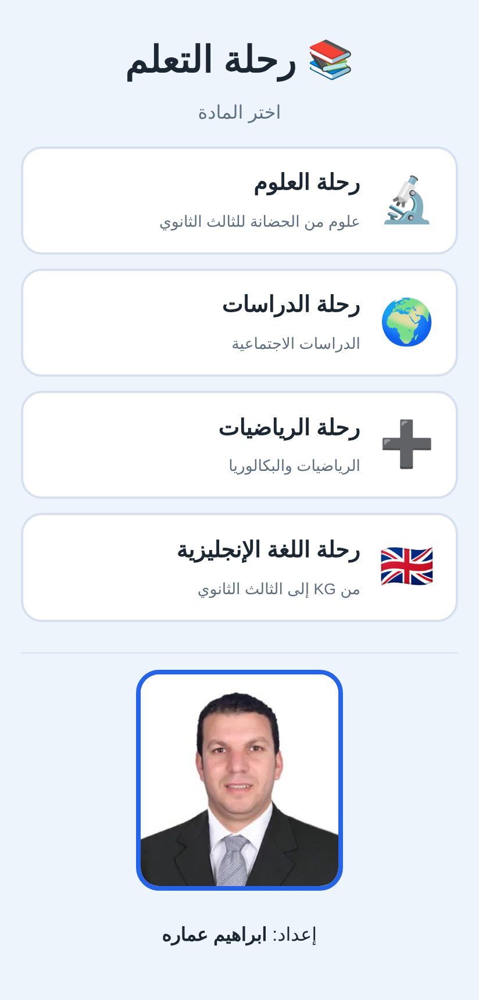
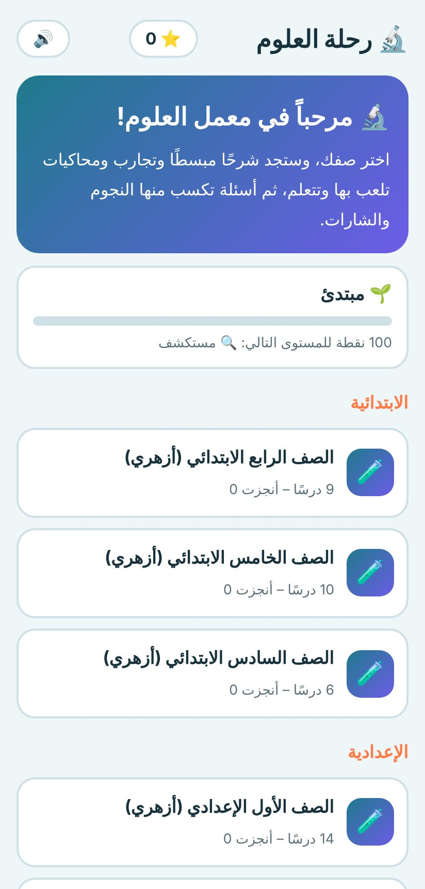
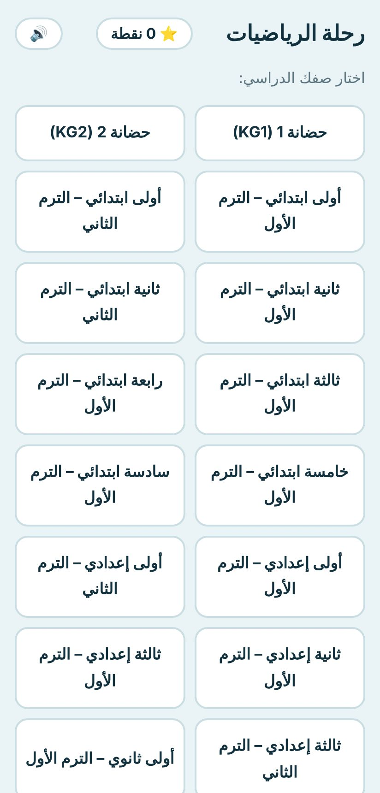
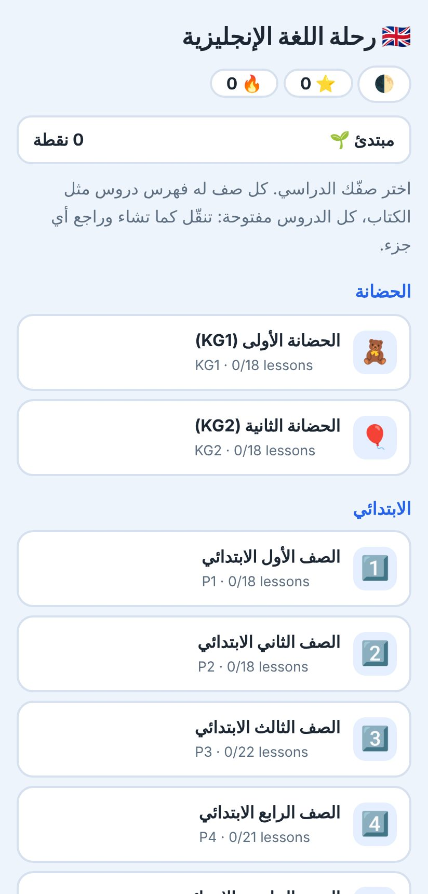
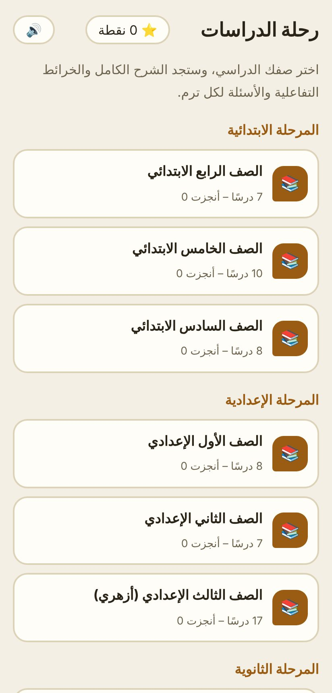

<div dir="rtl" align="right">

# 📚 رحلة التعلم

**تطبيق تعليمي تفاعلي مجاني باللغة العربية، من الحضانة لحد الثالث الثانوي.**
فيه أربع مواد: العلوم، والدراسات الاجتماعية، والرياضيات، واللغة الإنجليزية. كل الدروس مفتوحة، والتطبيق بيشتغل **من غير إنترنت**.

<p align="center">
  <br>
  <b>إعداد: إبراهيم عمارة</b>
</p>

---

## ⬇️ التحميل

| النظام | الملف | الحجم | التحميل |
|---|---|---|---|
| 📱 أندرويد (7.0 أو أحدث) | `rehla.apk` | 1.1 ميجا | [**تحميل نسخة الأندرويد**](../../releases/latest/download/rehla.apk) |
| 💻 ويندوز 10 / 11 | `rehla-windows.zip` | 0.4 ميجا | [**تحميل نسخة الويندوز**](../../releases/latest/download/rehla-windows.zip) |

كل النسخ والملاحظات موجودة في صفحة [الإصدارات (Releases)](../../releases).

> ⚠️ **ده الرابط الرسمي الوحيد.** ما تنزّلش التطبيق من أي موقع أو جروب تاني. وقبل التثبيت، قارن بصمة الملف بالجدول اللي في [التحقق من الملف](#-التحقق-من-الملف).

---

## ✨ إيه اللي في التطبيق؟

| المادة | المراحل | المميزات |
|---|---|---|
| 🔬 **رحلة العلوم** | من الحضانة للثالث الثانوي | محاكاة وتجارب تفاعلية زي البندول والعدسات والموجات والدوائر الكهربية، مع مسار للمنهج الأزهري |
| 🌍 **رحلة الدراسات** | الابتدائي والإعدادي والثانوي | خرائط تفاعلية وشرح كامل وأسئلة لكل درس |
| ➕ **رحلة الرياضيات** | من KG1 للثانوي | تمارين متدرجة لكل صف وترم، مع شرح الحل خطوة بخطوة |
| 🇬🇧 **رحلة اللغة الإنجليزية** | من KG للثالث الثانوي | كلمات بالصور والنطق، وترتيب جمل، وقطع قراءة بالترجمة، وقواعد |

- ⭐ **نقاط ونجوم ومستويات** بتشجّع الطفل يكمّل.
- 🔁 **مراجعة الأخطاء:** التطبيق بيفتكر الأسئلة الصعبة ويرجّعهالك.
- 🌙 **وضع ليلي** ووضع نهاري.
- 🔓 **كل الدروس مفتوحة**، فتقدر تتنقل وتراجع أي جزء في أي وقت.
- 🔊 **نطق الكلمات الإنجليزية** بصوت واضح، وبيشتغل من غير نت.

### صور من التطبيق

<p align="center">
  
  
  
  
  
</p>

---

## 📱 التثبيت على الأندرويد

1. افتح [رابط تحميل الأندرويد](../../releases/latest/download/rehla.apk) من الموبايل، واستنى لحد ما الملف ينزل.
2. افتح الملف من الإشعارات أو من فولدر **التنزيلات (Downloads)**.
3. لو ظهرت رسالة **«غير مسموح بتثبيت تطبيقات من هذا المصدر»**: دوس **الإعدادات** ← فعّل **السماح من هذا المصدر** ← وارجع.
4. دوس **تثبيت**.
5. لو ظهرت رسالة من **Play Protect** إن التطبيق مش معروف، دوس **مزيد من التفاصيل** ← **التثبيت على أي حال**. الرسالة دي بتظهر مع أي تطبيق مش منزّل من جوجل بلاي.

> 💡 **للتحديث بعد كده:** نزّل النسخة الجديدة من نفس الرابط وثبّتها فوق القديمة، وتقدّم الطفل هيفضل زي ما هو.
> لو كنت منزّل نسخة قديمة من مكان تاني، **امسحها الأول**.

## 💻 التشغيل على الويندوز

1. نزّل [نسخة الويندوز](../../releases/latest/download/rehla-windows.zip).
2. **كليك يمين** على الملف ← **Extract All (استخراج الكل)**.
3. افتح فولدر **Rehla-Windows** ودبل كليك على **«افتح رحلة التعلم»**.
4. التطبيق هيفتح في المتصفح (Edge أو Chrome) ويشتغل من غير إنترنت.

> 💡 عشان توصله بسرعة: كليك يمين على «افتح رحلة التعلم» ← **Send to** ← **Desktop (create shortcut)**.
> للرجوع من الدرس للقائمة، استخدم زرار الرجوع ← في المتصفح.

---

## 🛡️ الأمان والخصوصية

- 🚫 **مفيش صلاحيات خالص:** التطبيق ما بيطلبش إنترنت ولا كاميرا ولا ميكروفون ولا جهات اتصال ولا موقع ولا ملفات.
- 🔒 **مبيجمعش أي بيانات:** مفيش تسجيل دخول ولا إعلانات ولا تتبّع. التقدّم بيتحفظ على جهاز الطفل بس.
- ✍️ **موقّع رقمياً** بمفتاح المطوّر. لو حد عدّل التطبيق أو ضاف عليه أي حاجة، هتظهر رسالة **«تنبيه أمان»** والتطبيق هيقفل لوحده.
- 🧾 **فحص سلامة الدروس:** كل ما التطبيق يفتح، بيتأكد إن ملفات الدروس ما اتغيّرتش.
- 💻 نسخة الويندوز كلها صفحات HTML، **مفيهاش أي ملف تنفيذي (exe)**.

## 🔍 التحقق من الملف

بعد ما تنزّل الملف، تقدر تتأكد إنه هو الأصلي بالظبط عن طريق بصمته (SHA-256):

| الملف | البصمة (SHA-256) |
|---|---|
| `rehla.apk` (v1.1) | `3d119fb0ee74fbe6479ad361bbc7c0e3fd05204e9546bfcaa776d8ebed836434` |
| `rehla-windows.zip` (v1.1) | `d36ee862cc8c16ff8e03c419e3f6ba8a1baf051187da6a5263ff902aa540fc3d` |

**على الويندوز:** افتح PowerShell في فولدر التنزيلات واكتب:

</div>

```powershell
Get-FileHash .\rehla.apk -Algorithm SHA256
```

<div dir="rtl" align="right">

لازم الرقم اللي يطلع يطابق الجدول بالظبط. لو مختلف، **ما تثبّتش الملف** وامسحه.

بصمة شهادة التوقيع للمتخصصين:
`E2:5A:F5:A5:78:08:D6:26:7E:AA:6A:3D:5A:B0:B0:74:D2:35:03:AA:B3:88:D3:FE:61:FB:22:C5:AC:FA:74:EE`

---

## ❓ أسئلة شائعة

**هل التطبيق مجاني؟**
أيوه، مجاني بالكامل، ومفيهوش إعلانات ولا اشتراكات.

**محتاج إنترنت؟**
لأ. محتاج إنترنت مرة واحدة بس عشان تنزّله، وبعد كده بيشتغل من غير نت خالص.

**ليه مش على جوجل بلاي؟**
لسه. إن شاء الله يتنشر هناك قريب.

**ظهرتلي رسالة «تنبيه أمان» والتطبيق قفل.**
معناها إن النسخة اللي عندك اتعدّلت أو مش من المصدر الرسمي. امسحها ونزّل النسخة الأصلية من الرابط اللي فوق.

**زرار الصوت في الإنجليزي مش بيطلّع صوت.**
اتأكد إن عندك نسخة 1.1 أو أحدث. لو لسه مفيش صوت، افتح **الإعدادات** ← ابحث عن **تحويل النص إلى كلام** ← اختار **محرك Google** ← ونزّل **اللغة الإنجليزية**.

**التقدّم والنجوم اتمسحوا.**
التقدّم بيتحفظ على الجهاز نفسه. لو مسحت بيانات التطبيق أو بيانات المتصفح، أو غيّرت الجهاز، التقدّم هيبدأ من الأول.

---

## ⚖️ تنبيه وحقوق

- التطبيق **مبادرة شخصية تعليمية**، و**مش تابع** لوزارة التربية والتعليم ولا للأزهر الشريف ولا لأي جهة رسمية. الشرح والأسئلة متجهّزة بشكل مستقل على حسب موضوعات المنهج.
- لو لقيت أي غلطة في الدروس، بلّغ عنها من صفحة [Issues](../../issues).
- © 2026 إبراهيم عمارة. جميع الحقوق محفوظة. مسموح تستخدم التطبيق وتشارك **رابط الصفحة دي** مجاناً. ممنوع تعدّل التطبيق أو تعيد نشره أو تبيعه أو تنشره باسم تاني. التفاصيل في ملف [LICENSE](LICENSE).

<p align="center">لو التطبيق عجبك، شاركه مع غيرك 🤍<br>وادعيلي بالخير</p>

</div>
